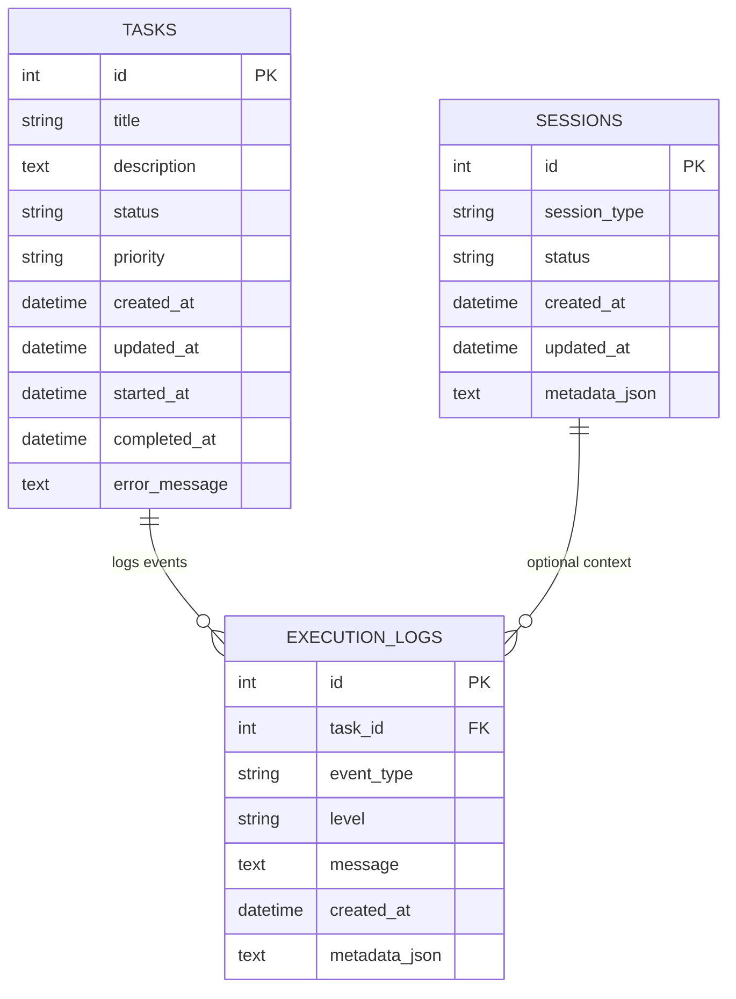

# VENORA AI — Architecture Specification (Phase 1)

> **Virtual Environment for Neural Operations, Reasoning & Assistance**  
> *Tagline: Think. Execute. Evolve.*

---

## 1. Architectural Overview

VENORA AI is engineered as a modular, local-first personal AI agent designed to run autonomously on Windows 11. Phase 1 establishes the foundational backend infrastructure: unified application configuration, relational persistence, structured logging, error handling, lifecycle management, and a RESTful API.

```
+-------------------------------------------------------------------------+
|                              Clients                                    |
|   (PowerShell CLI, Future Dashboard React Web App, Future Telegram Bot) |
+-------------------------------------------------------------------------+
                                    |
                                    | HTTP / JSON (Port 8000)
                                    v
+-------------------------------------------------------------------------+
|                          FastAPI Application                            |
|                                                                         |
|  +---------------------+  +--------------------+  +------------------+  |
|  | Request Size Limit  |  |  CORS Middleware   |  | Exception Filter |  |
|  +---------------------+  +--------------------+  +------------------+  |
|                                                                         |
|  +-------------------------------------------------------------------+  |
|  |                          API Router (/api/v1)                     |  |
|  |      /health, /health/ready, /tasks, /tasks/{id}, /cancel         |  |
|  +-------------------------------------------------------------------+  |
|                                   |                                     |
|  +--------------------------------v----------------------------------+  |
|  |                         Task Service Layer                        |  |
|  |     Validation, State Invariants, Transaction & Event Logging     |  |
|  +-------------------------------------------------------------------+  |
|                                   |                                     |
|  +--------------------------------v----------------------------------+  |
|  |                 SQLAlchemy 2.x ORM / Database Layer               |  |
|  |     Session Factory, Thread Isolation, Schema Definition          |  |
|  +-------------------------------------------------------------------+  |
+-------------------------------------------------------------------------+
                                    |
                                    v
+-------------------------------------------------------------------------+
|                             Storage Layer                               |
|        - SQLite Database: data/venora.db (Foreign Keys Enforced)        |
|        - Rotating File Logs: logs/venora.log                            |
+-------------------------------------------------------------------------+
```

---

## 2. Module Responsibilities

The codebase adheres strictly to layered architecture, separating presentation, business logic, configuration, and data persistence:

| Module | Location | Responsibility |
| :--- | :--- | :--- |
| **Configuration** | `backend/app/core/config.py` | Centralized type-safe settings loading via Pydantic Settings. Reads from `.env` and environment variables with conservative defaults. |
| **Logging** | `backend/app/core/logging.py` | Unified structured logging across console and size-based rotating file handlers (`logs/venora.log`). |
| **Errors** | `backend/app/core/errors.py` | Domain-specific exceptions (`TaskNotFoundError`, `InvalidTaskStateError`, `DatabaseConnectionError`). |
| **Database Session** | `backend/app/database/session.py` | SQLAlchemy 2.0 engine creation, SQLite PRAGMA enforcement, sessionmaker, and FastAPI request dependency (`get_db`). |
| **Schema Init** | `backend/app/database/init_db.py` | Idempotent table creation and migration bootstrap. |
| **Models** | `backend/app/models/` | Declarative SQLAlchemy models: `Task`, `Session`, and `ExecutionLog`. |
| **Schemas** | `backend/app/schemas/` | Pydantic v2 data transfer models for input validation, serialization, and OpenAPI documentation. |
| **Service Layer** | `backend/app/services/task_service.py` | Encapsulates all task business logic, lifecycle rules, pagination, terminal state guards, and operational audit logging. |
| **API Endpoints** | `backend/app/api/routes/` | Lean FastAPI routes delegating directly to services and handling HTTP response codes. |
| **Application** | `backend/app/main.py` | Lifespan orchestration, middleware assembly (size limiter, CORS), and global exception sanitization. |

---

## 3. Database Architecture

The persistence layer uses SQLAlchemy 2.x and SQLite, designed to transition smoothly to PostgreSQL in later phases without modifying application logic.

### Entity Relationship Model



### Key Database Guarantees
1. **Foreign Key Integrity**: Enforced via SQLite connection hook (`PRAGMA foreign_keys=ON;`).
2. **Timezone Uniformity**: All stored timestamps are explicitly UTC (`utc_now()`).
3. **Audit Trail**: Every task creation, status transition, or cancellation automatically writes an entry to `execution_logs`.
4. **Test Isolation**: Automated tests execute against isolated in-memory databases (`sqlite:///:memory:` with `StaticPool`), ensuring zero contamination of production data.

---

## 4. Request Flow & State Transitions

### Task State Machine

A task moves through defined states with strict integrity guards:

```
[ PENDING ] ──> [ PLANNING ] ──> [ AWAITING_APPROVAL ] ──> [ RUNNING ] ──> [ VERIFYING ] ──> [ COMPLETED ]
     │                │                     │                    │                 │
     v                v                     v                    v                 v
[ CANCELLED ]   [ CANCELLED ]         [ CANCELLED ]          [ FAILED ]        [ FAILED ]
```

*Rules:*
- **Cancellation**: Permitted only for tasks that have not started execution (`PENDING`, `PLANNING`, `AWAITING_APPROVAL`).
- **Terminal Invariant**: Tasks in terminal states (`COMPLETED`, `FAILED`, `CANCELLED`) cannot be updated or accidentally reopened through regular update endpoints.

---

## 5. Planned Extension Points (Future Phases)

VENORA AI Phase 1 provides clean architectural interfaces for future capabilities:

1. **Phase 2 (Desktop Observation & Automation)**: A dedicated `agent_executor` service will subscribe to `RUNNING` tasks and invoke native Windows OS automation drivers with explicit permission gates.
2. **Phase 3 (AI Reasoning & OpenRouter Integration)**: OpenRouter LLM client provider plugged into a reasoning planner pipeline without altering the core database schema.
3. **Phase 4 (Voice Interaction)**: Sarvam AI speech-to-text and text-to-speech pipelines communicating through audio streaming endpoints.
4. **Phase 5 (Remote Access & Telegram Bot)**: Secure webhook/polling adapter translating Telegram commands to authenticated `/api/v1` calls.
5. **Phase 6 (Web Dashboard)**: React + TypeScript dashboard communicating with `/api/v1` with WebSocket streaming for live execution logs.
